<div align="center">



<br/>


</div>

## `> whoami`

สวัสดีครับ ผม **Fluke NKN** 👋
สร้างระบบคลาวด์โฮสติ้ง บอท Discord และดูแลเซิร์ฟเวอร์ ตั้งแต่ฝั่งหน้าเว็บจนถึงหลังบ้าน

```text
$ now --building
  ▸ NEXORA CLOUD   hosting · mail · databases · bots · web verify
$ now --caring-about
  ▸ security first · clean deploys · things that just work
```

## `> stack`

| ชั้น | เครื่องมือ |
| --- | --- |
| Backend | Go (Fiber), PostgreSQL, Redis, MinIO |
| Frontend | Next.js, TypeScript |
| Infra | Docker Compose, Caddy, Cloudflare, Linux VPS |
| Bots | Discord (TypeScript) |

## `> stats`

<div align="center">


</div>

<div align="center">

<sub>🛡️ built with coffee, logs and a lot of <code>docker compose up -d</code></sub>

</div>
